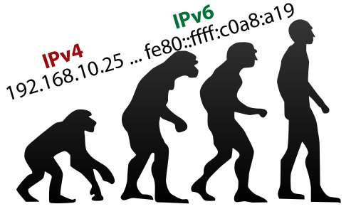

  

Создаю MCP-инфраструктуру, инструменты для разработчиков и приложения для игровых сообществ.

[Проекты](#проекты) &nbsp; / &nbsp; [Стек](#стек) &nbsp; / &nbsp; [Все репозитории ↗](https://github.com/NikitaRTN?tab=repositories)

---

## Проекты

**[MCP Hub 3 ↗](https://github.com/NikitaRTN/mcp-stack)** &nbsp; · &nbsp; Инфраструктура  
Self-hosted платформа для MCP-сервисов: процессы, инструменты, авторизация и живые журналы.  
`Python` · `JavaScript` · `SQLite`

**[Horizon Patcher ↗](https://github.com/NikitaRTN/Horizon-Patcher)** &nbsp; · &nbsp; Игровые инструменты  
Портативный патчер официального лаунчера Horizon: настройки приватности и проверка обновлений.  
`Rust` · `Windows`

**[OpenDoter ↗](https://github.com/NikitaRTN/OpenDoter)** &nbsp; · &nbsp; Dota 2  
Интерфейс для просмотра матчей и игроков; отдельно — [API и парсер реплеев](https://github.com/NikitaRTN/OpenDoter-API).  
`PHP` · `Java` · `Python`

**[SkHttp-Rework ↗](https://github.com/NikitaRTN/SkHttp-Rework)** &nbsp; · &nbsp; Minecraft  
HTTP/HTTPS-запросы и веб-интеграции для серверов Minecraft на Skript.  
`Java` · `Skript`

Также: [SkriptWebAPI ↗](https://github.com/NikitaRTN/SkriptWebAPI) — форк Web API и HTTP-сервера для Skript.

## Стек

**Языки** &nbsp; / &nbsp; Rust · Python · Java · JavaScript · PHP  
**Инструменты** &nbsp; / &nbsp; Git · GitHub Actions · SQLite · Caddy  
**Интеграции** &nbsp; / &nbsp; MCP · HTTP · OAuth · SSE

---

  

Вопросы и предложения — в Issues соответствующего проекта.
